# Smart Event Management and Ticketing System

## Project Overview

The **Smart Event Management and Ticketing System** is a full-stack web application developed using **ASP.NET Core MVC, C#, Microsoft SQL Server, and Entity Framework Core**.

The application was developed for an academic scenario involving a metropolitan cultural council seeking to modernize cultural event management, ticket reservations, and attendance verification.

The system provides a centralized platform for event discovery, ticket booking, venue management, reviews, inquiries, and administrative operations.

It supports four user roles: **Guest, Member, Staff, and Administrator**, each with distinct permissions and functionality.

**Project Type:** Full-Stack Web Application  
**Architecture:** Model-View-Controller (MVC)  
**Backend:** C# and ASP.NET Core MVC  
**Database:** Microsoft SQL Server  
**Frontend:** HTML, CSS, Bootstrap, JavaScript  
**Project Status:** Developed Academic Web Application

---

## 1. Business Problem

Traditional event management processes can create operational challenges for cultural organizations, including:

- Inefficient event scheduling and administration.
- Limited visibility into ticket availability.
- Fragmented event information and public communication.
- Difficulties managing ticket reservations.
- Manual attendee verification.
- Limited mechanisms for collecting feedback.
- Inconsistent coordination between event organizers and attendees.

The system addresses these challenges through an integrated event management and ticketing platform.

## 2. System Objectives

The project's primary objectives were to:

- Develop a centralized web-based event management application.
- Provide event browsing and filtering functionality.
- Enable registered members to book event tickets.
- Manage event sessions, venues, categories, and availability.
- Implement role-based authentication and authorization.
- Support event reviews and inquiry submission.
- Provide administrative event management functionality.
- Enable staff to verify bookings during event check-in.
- Develop and implement a relational SQL Server database.
- Demonstrate functional testing and database validation.

---

## 3. Technologies and Tools

| Technology | Purpose |
|---|---|
| C# | Backend application programming |
| ASP.NET Core MVC | Web application framework |
| Entity Framework Core | Object-relational mapping |
| Microsoft SQL Server | Relational database |
| SQL Server Management Studio | Database administration and SQL execution |
| Oracle SQL Developer Data Modeler | Logical and relational database design |
| HTML | Interface structure |
| CSS | Styling |
| Bootstrap | Responsive user interface |
| JavaScript | Client-side interactions |
| Visual Studio | Development environment |

---

## 4. System Architecture

The application follows a three-tier architecture.

### Presentation Layer

Developed using Razor views, HTML, CSS, Bootstrap, and JavaScript.

This layer provides the interfaces for event browsing, user authentication, ticket booking, administration, and check-in verification.

### Application Logic Layer

ASP.NET Core MVC controllers handle requests, enforce business rules, validate user input, and coordinate operations between views and database models.

### Data Layer

Microsoft SQL Server manages persistent application data, including users, events, event sessions, ticket types, bookings, payments, reviews, and inquiries.

Entity Framework Core connects the application to the relational database.

---

## 5. Application Features and Screenshots

### 5.1 Homepage

The homepage provides an overview of the metropolitan cultural council and upcoming cultural events.

Users can explore general information, browse upcoming events, register, log in, and submit inquiries.

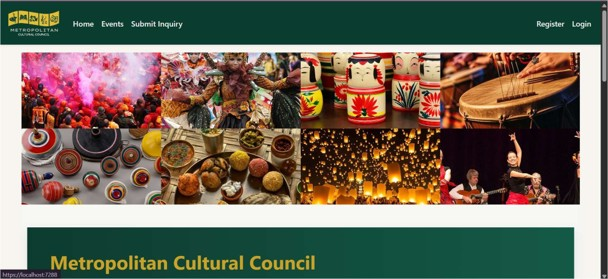

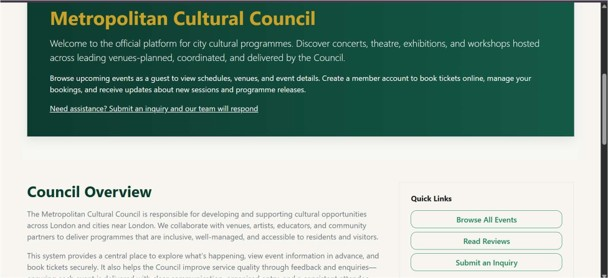

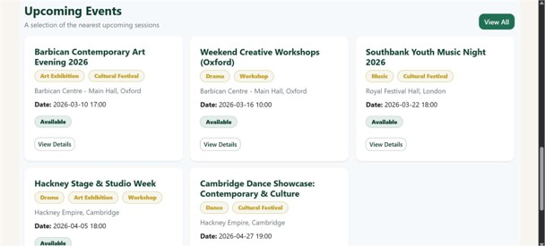

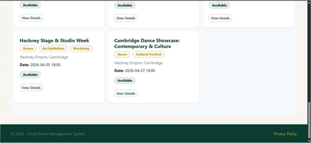

### 5.2 Event Browsing and Searching

The application provides an event discovery interface where users can browse cultural events and search using different criteria.

Available filtering options include:

- Event category
- City
- Venue
- Event date

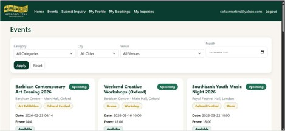

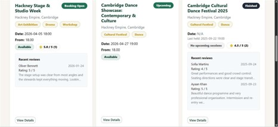

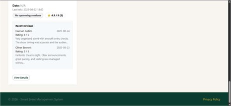

#### Event Filtering

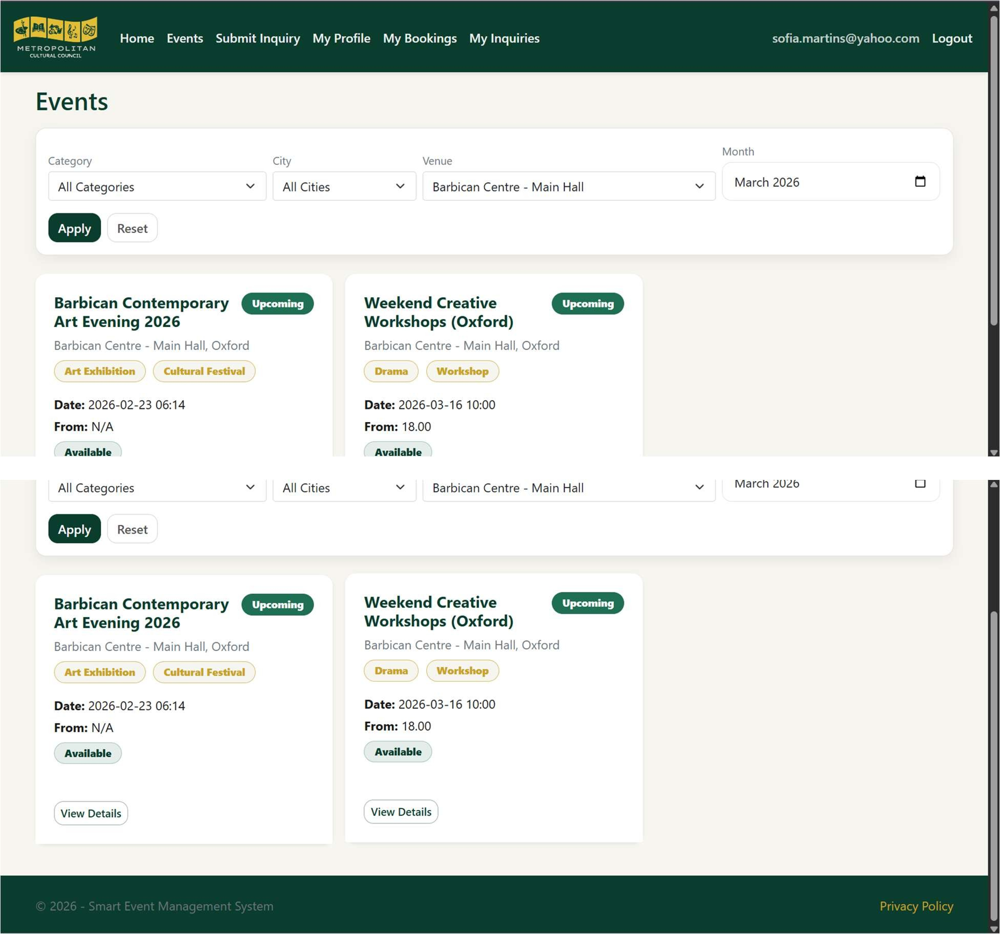

### 5.3 Ticket Booking System

Authenticated members can select event sessions, view available ticket types, and choose ticket quantities.

The booking workflow includes:

1. Selecting an event.
2. Choosing an event session.
3. Viewing available ticket types.
4. Selecting ticket quantities.
5. Validating seat availability.
6. Calculating the booking total.
7. Creating the booking record.
8. Viewing the booking and payment status.

#### Ticket Selection

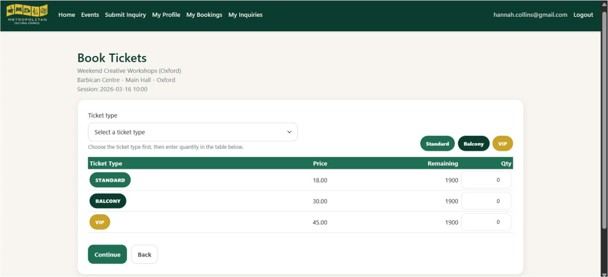

#### Booking Before Payment Confirmation

#### Booking After Payment Confirmation

**Note:** The academic application demonstrates payment confirmation and payment-status management, but a live payment gateway was not integrated.

### 5.4 Member Booking Management

Members can view their existing reservations and inspect booking details.

The booking interface provides information such as:

- Event name
- Event session
- Booking reference
- Ticket quantity
- Total amount
- Booking status
- Payment status

#### My Bookings

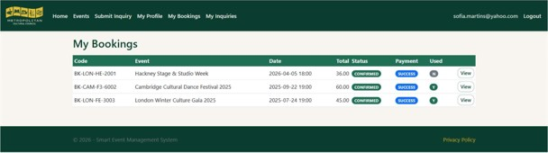

#### Booking Details

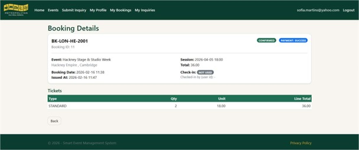

### 5.5 Administrator Module

The administrator module provides management functionality for events, venues, categories, sessions, inquiries, and reviews.

Administrators can access system information and perform role-restricted management tasks.

#### Administrator Dashboard

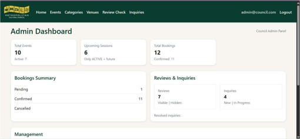

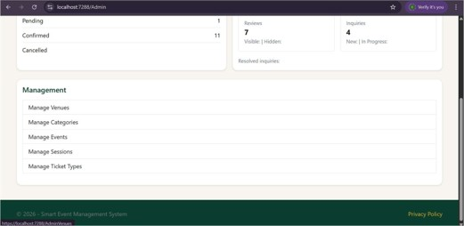

#### Event Management

Administrators can create, update, and manage event records.

They can also manage event sessions, associated categories, venues, and event availability.

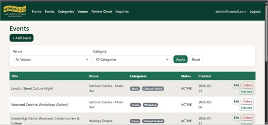

### 5.6 Staff Module — Ticket Verification

Staff members can verify attendee bookings during event check-in.

The verification process involves:

- Entering the booking code.
- Entering the last two digits of the member's registered phone number.
- Validating booking records.
- Checking booking and payment eligibility.
- Recording successful attendance verification.

### 5.7 Additional User Features

The academic application also includes:

**Member Registration and Login**
- Account registration
- Credential-based authentication
- Member role assignment

**Reviews**
- Review submission by eligible attendees
- Event ratings and comments
- Administrator review moderation

**Inquiries**
- Guest inquiry submission
- Member inquiry submission
- Administrative inquiry handling and responses

**Profile Management**
- Member profile information
- Permitted contact-information updates

---

## 6. Database Design

The system's database was modelled using Oracle SQL Developer Data Modeler and implemented with Microsoft SQL Server.

The project demonstrates database planning, relational modelling, schema implementation, and data validation.

### 6.1 Entity-Relationship Diagram

The ERD illustrates the database entities and relationships supporting event management, ticket reservations, payments, and user interactions.

### 6.2 Relational Database Model

The relational model demonstrates how the entities are structured into related tables, including primary keys, foreign keys, and other constraints.

### 6.3 Main Database Entities

The database includes 12 primary entities:

1. User
2. Venue
3. Category
4. Event
5. Event Category
6. Event Session
7. Ticket Type
8. Booking
9. Booked Tickets
10. Payment
11. Review
12. Inquiry

### 6.4 Database Constraints

The project demonstrates:

- Primary key constraints
- Foreign key constraints
- Composite keys
- Unique constraints
- Check constraints
- Default constraints
- Not-null constraints
- Data type validation
- Referential integrity

### 6.5 Database Implementation

Database implementation activities included:

- Creating relational tables
- Defining entity relationships
- Implementing Entity Framework Core models
- Configuring `ApplicationDbContext`
- Applying Entity Framework Core migrations
- Populating sample records
- Executing SQL INSERT statements
- Retrieving records using SELECT queries
- Validating stored data

---

## 7. Authentication and Role-Based Access Control

The application implements role-specific functionality.

| Functionality | Guest | Member | Staff | Administrator |
|---|---|---|---|---|
| Browse Events | Yes | Yes | Yes | Yes |
| View Ticket Prices | No | Yes | No | Yes |
| Book Tickets | No | Yes | No | No |
| View Personal Bookings | No | Yes | No | No |
| Submit Reviews | No | Yes | No | No |
| Submit Inquiries | Yes | Yes | No | No |
| Manage Events | No | No | No | Yes |
| Manage Venues | No | No | No | Yes |
| Moderate Reviews | No | No | No | Yes |
| Handle Inquiries | No | No | No | Yes |
| Verify Attendee Check-ins | No | No | Yes | No |

Role-based authorization separates public functionality from sensitive booking, management, and operational activities.

---

## 8. Testing and Validation

The project includes documented functional and database testing.

### Functional Testing

The testing activities covered:

- User registration
- User authentication
- Event browsing and filtering
- Ticket booking
- Booking confirmation
- Seat availability validation
- Member booking history
- Review submission
- Inquiry submission
- Administrative event management
-
